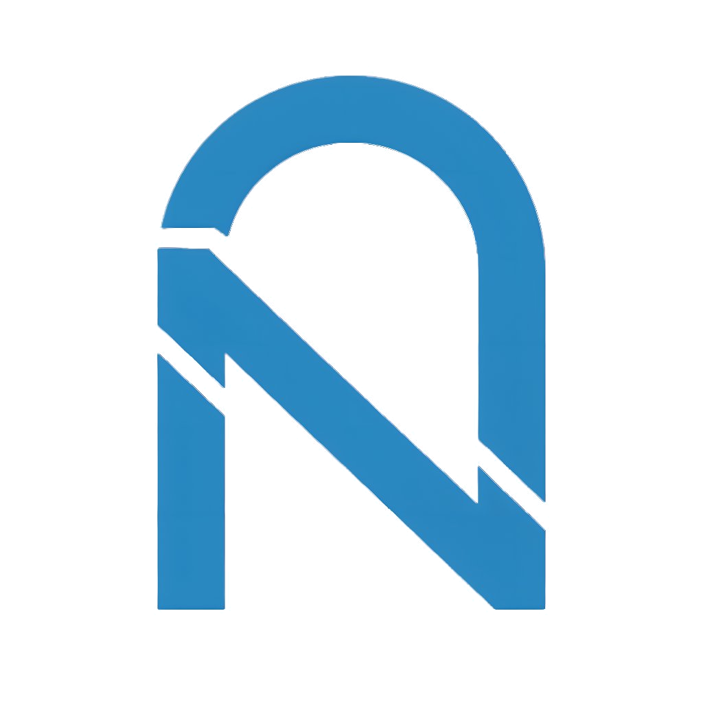

<p align="center">
  
</p>

<h1 align="center">carea</h1>

<p align="center">
  <strong>Craft And Reverse Engineer Everything</strong><br>
  <em>"Break It Down. Build It Better."</em>
</p>

<p align="center">
  An independent, unofficial Level-1 agent skill pack, airlock CLI, and dual-axis verification layer coordinating external <strong>REA</strong> and <strong>Craft Anything</strong> engines.
</p>

---

## What `carea` Is — and What It Is Not

### What `carea` provides
- **Three non-conflicting agent skills** across `.claude-plugin/`, `.codex-plugin/`, and `.cursor-plugin/`:
  - [`/carea`](skills/carea/SKILL.md): Combined pipeline (`REA -> Airlock -> CA -> Dual Parity`) and automatic router across Modes 1–6.
  - [`/rea`](skills/rea/SKILL.md): REA-first static/runtime investigation, `ev_...` / `unk_...` evidence tracking, formal verification, and AgentEnv export.
  - [`/ca`](skills/ca/SKILL.md): Craft Anything-first observable UI study, clean-room rebuild, visual pixel diffs, and original asset generation.
- **Zero-dependency Python 3.10+ stdlib CLI (`carea`):** Replaces honor-system clean-room claims with real checks (`init`, `doctor`, `validate-handoff`, `airlock-lint`, `airlock-sign`, `isolation-check`, `spec-draft`, `parity-report`, `return-feedback`, `mcp-profile`).
- **Dual-axis parity & versioned handoff schema (`1.1.0`, `1.0.0`-compatible):** Maps CA visual/walkthrough checks alongside REA behavioral/structural verification (`schemas/carea-handoff.schema.json`).

### What `carea` is NOT
- **Not a merged codebase or analysis engine:** `carea` contains zero vendored source code, binaries, fonts, or logos from REA or Craft Anything. You install and run both upstream engines externally.
- **Not a legal clean room or OS sandbox:** `carea`'s Two-Team Clean Room workflow and `carea airlock-lint` are **engineering process aids**, not legal advice or operating-system isolation. See [`DISCLAIMER.md`](DISCLAIMER.md) and [`docs/threat-model.md`](docs/threat-model.md).
- **Not affiliated with upstream maintainers:** `carea` is an independent, unofficial project by Ahmed Ishtiaque Zarir and is not endorsed by `morluto` or `ArtCraft Team / storytold`.

---

## Install & Verify Upstream Prerequisites

1. **Install REA (`rea-agents`, MIT)** — requires Node.js `^22.23.4 || ^24.22.1 || >=26.12.1`:
   ```bash
   npm install -g rea-agents@6.10.1
   rea --version && rea doctor
   ```
2. **Install Craft Anything (`craft-anything-cli`, MIT OR Apache-2.0)** *(early alpha)*:  
   Download an official archive from [storytold/craft-anything Releases](https://github.com/storytold/craft-anything/releases) (or build from source with Cargo), then check:
   ```bash
   craft-anything-cli --version
   craft-anything-cli doctor
   ```
3. **Install `carea` CLI & check compatibility** (Python 3.10+, zero external pip dependencies):
   ```bash
   pip install --no-deps .
   carea doctor
   ```
   Or without installing globally:
   - Linux/macOS: `bash scripts/carea doctor` and `bash scripts/verify-upstream.sh`
   - Windows PowerShell: `.\scripts\carea.ps1 doctor` and `.\scripts\verify-upstream.ps1`

See [`docs/compatibility.md`](docs/compatibility.md) (generated from [`compat/matrix.json`](compat/matrix.json)), [`docs/upstream-facts.md`](docs/upstream-facts.md), and [`docs/coexistence.md`](docs/coexistence.md).

---

## 5-Minute Quickstarts

### Quickstart A — `/rea` (Mode 3: Deep Inspection & Verification)
Use when investigating a self-owned or authorized package, firmware image, or JS bundle without running a UI rebuild:
```bash
# Inspect lean REA hot-cold MCP config before adding to your client
carea mcp-profile rea-hot-cold
```
In your agent prompt, invoke `/rea`: inspect target artifacts (`open_binary`, `analyze_javascript_application`, `inspect_artifact`), record unresolved gaps with `record_unknown`, and verify declared obligations with `verify_reconstruction` or export via `export_environment_bundle`.  
Guide: [`docs/workflows/binary-parity-rebuild.md`](docs/workflows/binary-parity-rebuild.md).

### Quickstart B — `/ca` (Mode 1: Clean-Room UI Rebuild)
Use when recreating an observable web or desktop UI using Craft Anything `--clean-room` only:
```bash
# Serve the self-owned sample target locally
python examples/sample-target/server.py --port 4173

# Inspect minimal Craft Anything MCP profile (no --all-tools)
carea mcp-profile ca-clean-room
```
In your agent prompt, invoke `/ca` against `http://127.0.0.1:4173/`: verify `core_session_show` reports `clean_room: true`, capture views with `web_site_open` -> `web_site_capture` -> `web_page_states_capture`, rebuild cleanly, and check UI likeness with `rebuild_check` and `web_pixels_compare`.  
Guide: [`docs/workflows/clean-room-ui-rebuild.md`](docs/workflows/clean-room-ui-rebuild.md).

### Quickstart C — `/carea` (Mode 2: Two-Team Clean Room + Airlock CLI)
Use when internal state machines or HTTP contracts must inform a separate clean rebuild:
```bash
# 1. Create isolated 4-directory project layout and verify separation
carea init ./my-rebuild --mode two-team-process --topology b --target-name pulse-timer
carea isolation-check ./my-rebuild

# 2. After Lane A exports analyst-evidence/bundle.json, draft a spec skeleton (IDs only)
carea spec-draft ./my-rebuild/analyst-evidence/bundle.json --out ./my-rebuild/airlock/clean-room-spec.md

# 3. Edit spec & handoff, run heuristic leak scanner, validate schema, and sign after human review
carea airlock-lint ./my-rebuild/airlock --strict
carea validate-handoff ./my-rebuild/airlock/carea-handoff.json
carea airlock-sign ./my-rebuild/airlock/carea-handoff.json --reviewer "YourName" --confirm-human-review

# 4. After Lane B (Topology b fresh MCP session) builds & checks run, merge dual parity
carea parity-report --handoff ./my-rebuild/airlock/carea-handoff.json --ca-report ca.json --rea-report rea.json --out ./my-rebuild/verification/parity-checklist.md
```
Guide: [`docs/workflows/two-team-clean-room.md`](docs/workflows/two-team-clean-room.md).

---

## Mode Chooser (`skills/carea/references/modes.md`)

| Mode | ID | Skill | Clean-Room? | Use When |
| --- | --- | --- | --- | --- |
| **1. Clean-Room UI Rebuild** | `clean-room-ui` | `/ca` | Tool-level (`--clean-room`) | Visual layout, styling, and public web/app UI suffice |
| **2. Two-Team Clean Room** | `two-team-process` | `/carea` | Process aid (`airlock/`) | Hidden state machines/APIs require REA -> Airlock -> CA + Dual Parity |
| **3. Deep Investigation / AgentEnv** | `deep-verification` | `/rea` | N/A | Forensics, `verify_reconstruction`, capture diffs, or AgentEnv export |
| **4. Private Deep Rebuild** | `private-deep-rebuild` | `/carea` | **NO** (`deep_private: true`) | First-party/authorized migration combining REA + CA `--deep` (prints loud non-clean-room banner) |
| **5. Game Rebuild Path** | `game-rebuild` | `/carea` / `/ca` | Only without `game_*` / `--deep` | Recreating mechanics in Unity/Unreal/Godot with generated assets (`game_*` extraction is Deep-only; no asset copying) |
| **6. Android / Mobile App Path** | `android-mobile` | `/carea` | Only across Airlock | Pairing REA `android`/`apktool`/`flutter`/`frida` logic with CA `adb` screenshots |

Detailed walkthroughs: [`docs/workflows/private-deep-game-mobile.md`](docs/workflows/private-deep-game-mobile.md).

---

## Honest Status & Known Limits

- **Upstream alpha maturity:** `craft-anything-cli` is explicitly **early alpha**; tool availability (`322` commands in `0.6.0`, `303` engine tools / `320` total in `0.6.1`) and CLI flags can shift across releases.
- **Verification ceiling:** Parity checks are only as strong as upstream evidence (`verify_reconstruction` checks only declared finite claims in its `specification`, never global equivalence).
- **Heuristic airlock:** `carea airlock-lint` catches common structural leaks (code fences, asm, hex dumps, minified JS, base64, assets, secrets, `analyst-evidence/` paths, long prose) and NEVER proves zero leakage. Human review and Topology `(b)` separation remain essential (`docs/threat-model.md`).
- **Build-host observation bounds:** See [`docs/upstream-facts.md`](docs/upstream-facts.md) and [`docs/AUDIT.md`](docs/AUDIT.md) for what was executed on the build host vs verified only from pinned upstream source (`rea` CLI execution was unrun on the build host because Node.js `>=22` was absent).

---

## Documentation Index

- **Architecture:** [`docs/architecture/architecture.md`](docs/architecture/architecture.md) & [`carea-architecture.mmd`](docs/architecture/carea-architecture.mmd)
- **Setup & Coexistence:** [`docs/getting-started.md`](docs/getting-started.md) · [`docs/coexistence.md`](docs/coexistence.md) · [`docs/compatibility.md`](docs/compatibility.md)
- **Schemas & Templates:** [`schemas/README.md`](schemas/README.md) · [`schemas/carea-handoff.schema.json`](schemas/carea-handoff.schema.json) · [`templates/`](templates/clean-room-spec.template.md)
- **Security & Help:** [`docs/threat-model.md`](docs/threat-model.md) · [`docs/faq.md`](docs/faq.md) · [`docs/troubleshooting.md`](docs/troubleshooting.md) · [`docs/AUDIT.md`](docs/AUDIT.md)

---

## Licensing, Trademarks & Credits

- **Original code, CLI, skills, schemas & docs:** [MIT License](LICENSE) (`Copyright (c) 2026 Ahmed Ishtiaque Zarir`). MIT applies strictly to original `carea` materials.
- **Brand & trademarks:** The name **carea**, full title **Craft And Reverse Engineer Everything**, tagline **"Break It Down. Build It Better."**, and [`docs/brand/carea.png`](docs/brand/carea.png) are trademarks of Ahmed Ishtiaque Zarir and are excluded from the MIT License. See [`BRAND.md`](BRAND.md) and [`docs/brand/LICENSE-brand.txt`](docs/brand/LICENSE-brand.txt).
- **Upstream credits & notices:** Preserved in [`NOTICE`](NOTICE) and [`THIRD_PARTY_NOTICES.md`](THIRD_PARTY_NOTICES.md). `carea` coordinates **[REA (`morluto/rea`)](https://github.com/morluto/rea)** and **[Craft Anything (`storytold/craft-anything`)](https://github.com/storytold/craft-anything)** without affiliation or endorsement.
