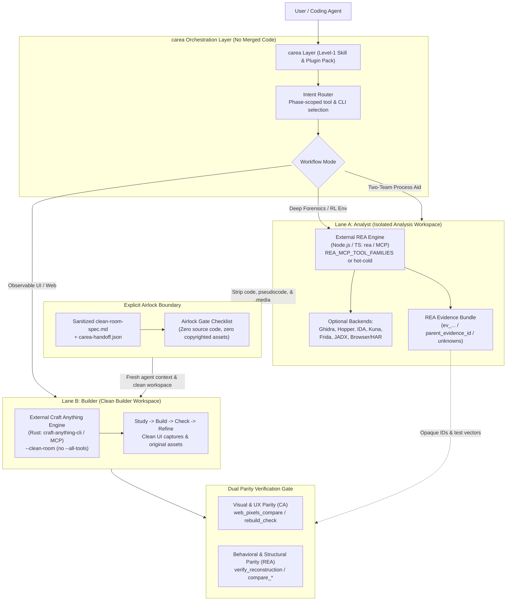

# `carea` Architecture

`carea` (**Craft And Reverse Engineer Everything**) is a **Level-1 orchestration layer**: an agent skill pack, routing playbook, clean-room process protocol, and handoff schema. Rather than rewriting or merging **REA** (TypeScript / Node.js) and **Craft Anything** (Rust), `carea` drives both as **independent external processes** through their own CLI commands and MCP servers.

---

## 1. Architectural Diagram

Source file: [`carea-architecture.mmd`](carea-architecture.mmd)

---

## 2. Why Keep Both Stacks Separate?

| Design Choice | Rationale |
|---|---|
| **Zero merged codebases** | REA runs on Node.js with Python/Java/Swift/native bridges; Craft Anything is pure Rust (`unsafe_code = "forbid"`, dual-licensed MIT/Apache-2.0, currently early alpha). Orchestrating them via CLI/MCP keeps upstream updates clean and avoids maintenance drift. |
| **Zero redistributed binaries** | Users install official builds directly from `morluto/rea` (`rea-agents`) and `storytold/craft-anything`, respecting upstream license terms, platform builds, and optional commercial tool boundaries. |
| **Complementary strengths** | REA specializes in deep binary/JS/protocol forensics, obligation ledgers, reconstruction verification, and AgentEnv export. Craft Anything specializes in clean-room observable web/UI rebuilding, pixel diffing, asset generation, and multi-round project loops. |

---

## 3. Core Architectural Mechanisms

1. **Intent Router (Context-Budget Control):**
   Exposing both complete catalogs at once floods agent context with 500+ tool schemas. `carea` routes each task phase to either `rea` (via `REA_MCP_TOOL_FAMILIES`, `REA_MCP_TOOL_CATALOG_PROFILE=hot-cold`, or one-shot CLI calls) or `craft-anything-cli` (via `mcp` without `--all-tools`, or one-shot `triage`/`rebuild`/`report`), keeping active schemas minimal.
2. **Two-Team Clean Room Airlock (Process Aid):**
   When reconstructing non-trivial software, Lane A (Analyst, using REA) stays in an isolated analysis directory and emits only a sanitized functional specification (`clean-room-spec.md`) plus an opaque handoff record (`carea-handoff.json`). Lane B (Builder, using Craft Anything `--clean-room` in a fresh agent context and clean directory) reads only that sanitized spec and observable appearance. *As detailed in [`../../DISCLAIMER.md`](../../DISCLAIMER.md), this is a process aid, not a legal clean-room guarantee or an OS sandbox.*
3. **Dual Parity Verification:**
   Rebuilt outputs can be checked on two axes: visual/responsive likeness via Craft Anything (`web_pixels_compare`, `web_walkthrough_check`, `runtime_captures_compare`, `rebuild_check`) and behavioral/structural coverage via REA (`verify_reconstruction`, `evaluate_reconstruction_coverage`, `compare_source_to_bundle`, `compare_process_captures`, `correlate_static_and_runtime`).
