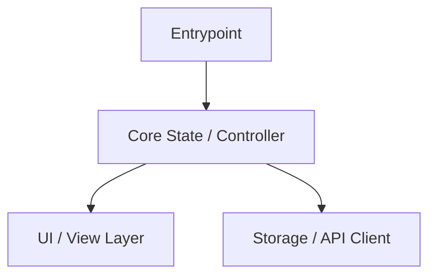

# Extracted System Architecture Blueprint (`architecture.md`)

> **Scope Notice:** Replace `[ ]` checkboxes and placeholder sections with **directly observed** REA evidence (`ev_...`), Craft Anything runtime captures, **inferred** behavior (explicitly labeled `[INFERRED]`), and unresolved **unknowns** (`unk_...`).
> **Authorization & Clean-Room Status:** State whether internals were analyzed directly (`deep_private: true` — **NOT clean-room**) or strictly across a sanitized `airlock/`.

- **Target:** `<apk | url | exe | folder>`
- **Target Kind:** `<android-apk | web-app | electron-app | native-binary | managed-assembly | game | firmware>`
- **Analysis Mode:** `<auto-direct (deep_private: true) | clean-room-airlock | clean-room-ui>`
- **Verified Engine Evidence IDs:** `<ev_...>`

---

## 1. Executive Summary & Tech Stack

- **Runtime / Framework:** `<Observed runtime, UI framework, bundler, or native toolchain>`
- **Entrypoints:** `<Main activity / HTML root / PE entry / CLI binary>`
- **Packaging Structure:** `<Directories, bundles, DEX/SO libraries, WASM modules, or Electron ASAR layout>`

---

## 2. Module Graph & Component Responsibilities

| Component / Module | Role | Inputs | Outputs / Side Effects | Evidence / Confidence |
| --- | --- | --- | --- | --- |
| `<module>` | `<responsibility>` | `<inputs>` | `<outputs>` | `ev_...` (`Observed` / `Inferred`) |

---

## 3. State Machines & Core Workflows

| State | Event / Trigger | Guard | Next State | Observable Effect |
| --- | --- | --- | --- | --- |
| `<idle>` | `<action>` | `<condition>` | `<active>` | `<effect>` |

---

## 4. API, IPC, & Storage Contracts

- **Network Endpoints / Schemas:** `<Method + Route + abstract JSON schema>`
- **Local Persistence:** `<SQLite tables / SharedPreferences / IndexedDB / localStorage keys>`
- **IPC / Native Bridges:** `<JNI signatures, Electron preload channels, or FFI symbols>`

---

## 5. Security Boundaries & Open Unknowns (`unk_...`)

- **Unanalyzed / Encrypted / Dynamic Gaps:**
  - `unk_01`: `<Path/logic not observed without live test credentials or native runtime>`
- **Parity Readiness:** Link every claim above to verification tests before claiming equivalence.
